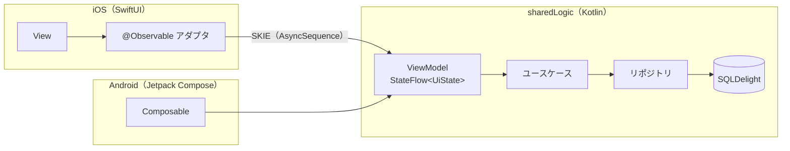

# アーキテクチャ

Moneging のクライアント（`clients/kmp`）の構成と、状態・ライフサイクルの規則。

## 全体像

- 画面の状態は共有の ViewModel が1つの `StateFlow<UiState>` で公開する。UI は操作を ViewModel に送り、新しい状態を受け取るだけ（単方向）。
- iOS は SKIE で Flow を `AsyncSequence` として受け取る。
- データは端末内の SQLDelight。更新はリポジトリが Flow で流す。
- 依存関係は Koin で組み立てる。

## 対象

- iOS 26 以上（Liquid Glass のタブバー、`tabViewBottomAccessory`、Foundation Models）
- Android 14（API 34）以上

## 状態とライフサイクルの規則

1. 依存関係のコンテナはアプリ起動時に1回だけ作る。
2. タブは標準の `TabView`（`Tab` API）。各タブが自分の `NavigationStack` を持ち、
   遷移の状態はアプリ全体の状態として保持する。タブを切り替えても画面を作り直さない。
3. 状態を持つオブジェクトは画面ごとに1回だけ生成して `@State` に置く。`body` の中で
   生成しない。タブの最初の画面の分はアプリの生存期間中ずっと保持する。
4. データは DB の変更を監視して流す。画面が表示されるたびに取り直さない。
5. UI/UX に関わる変更は、シミュレーターでアプリを実際に操作して確認してから完了とする。
