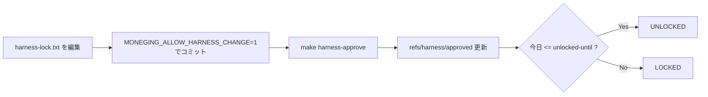

# ハーネスガイド

Moneging の Repository Harness は3層で品質と保護ルールを強制する。

## 3層

1. **PreToolUse（ツール実行前）**: `scripts/guard/tool-policy.ts` が Edit/Write/
   NotebookEdit/Bash を検査する。`quality/protected-paths.txt` に列挙されたパス
   への書き込みは、ハーネスが LOCKED の間は拒否される。`--no-verify`、
   `core.hooksPath` の書き換え、`git push --force`、`MONEGING_ALLOW_HARNESS_CHANGE`
   の付与などハーネスを回避する Bash コマンドはロック状態に関わらず常に拒否
   される。
2. **Stop（ターン終了時）**: `scripts/guard/stop-gate.sh` が未追跡ファイルの有無
   を確認し、`make -k verify` を実行する。`harness-check` はベースラインに関係
   なく常にグリーンでなければならない。それ以外のゲートは、前のターンで通って
   いたものが新たに落ちた場合だけターンを止める。3回連続で拒否すると諦めて
   ユーザーに伝える（その判定は同一のツリー状態にキャッシュされ、ツリーが変わ
   るまで再判定しない）。
3. **git hooks**: `hooks/pre-commit` は、ハーネスが LOCKED かつ
   `MONEGING_ALLOW_HARNESS_CHANGE=1` が無い間、ステージ済みの保護パス変更を
   拒否する（常に保護される2ファイルは UNLOCKED でもこの確認が要る）。
   `hooks/pre-push` は `make check` をフルで実行する。

## 何が保護されているか

`quality/protected-paths.txt` に列挙: `quality/` `hooks/` `scripts/guard/`
`scripts/hooks/` `scripts/quiet.sh` `Makefile` `mise.toml` `.claude/`
`CLAUDE.md` `.gitignore` `clients/kmp/.gitignore` と、Gradle の一部設定ファイル。

このうち以下の4つは「常に保護」（`scripts/guard/protected-entries.ts` の
`ALWAYS_PROTECTED`）で、ロックの開閉に関わらず常に拒否される
（ロック機構自体の整合性と、`.git` や Claude Code のローカル設定を守るため）:
`.git` `.claude/settings.local.json` `quality/harness-lock.txt`
`scripts/guard/harness-lock.ts`。

## ロックと変更手順

ハーネスの状態は作業ツリーの `quality/harness-lock.txt` ではなく、git 参照
`refs/harness/approved` にコミットされている内容で決まる。今日の日付がそこに
書かれた `unlocked-until` 以前なら UNLOCKED、それ以外は LOCKED。

人間がハーネスを変更する手順（セッション内では拒否される。人間自身のシェルで
実行する）:

1. `quality/harness-lock.txt`（または変更したいハーネスファイル）を編集する
2. `MONEGING_ALLOW_HARNESS_CHANGE=1` を設定してコミットする
3. `make harness-approve` を実行し、今の HEAD を承認済み状態として記録する



## 初回セットアップ

```sh
mise install   # mise.toml に固定した node/java を導入（make tools でも可）
make hooks     # git hooks を hooks/ に向ける
```

## 主な make ターゲット

- `make verify` — 高速チェック一式（harness-check, guard-protected,
  guard-ignored, guard-toolchain, kmp-test）。Stop hook が実行するのと同じ。
- `make check` — verify に加え、Android/iOS のビルドとフルテストスイート。
  push 前に実行する。
- `make tools` — mise.toml のバージョンをインストール。
- `make hooks` — git hooks を配線する。
